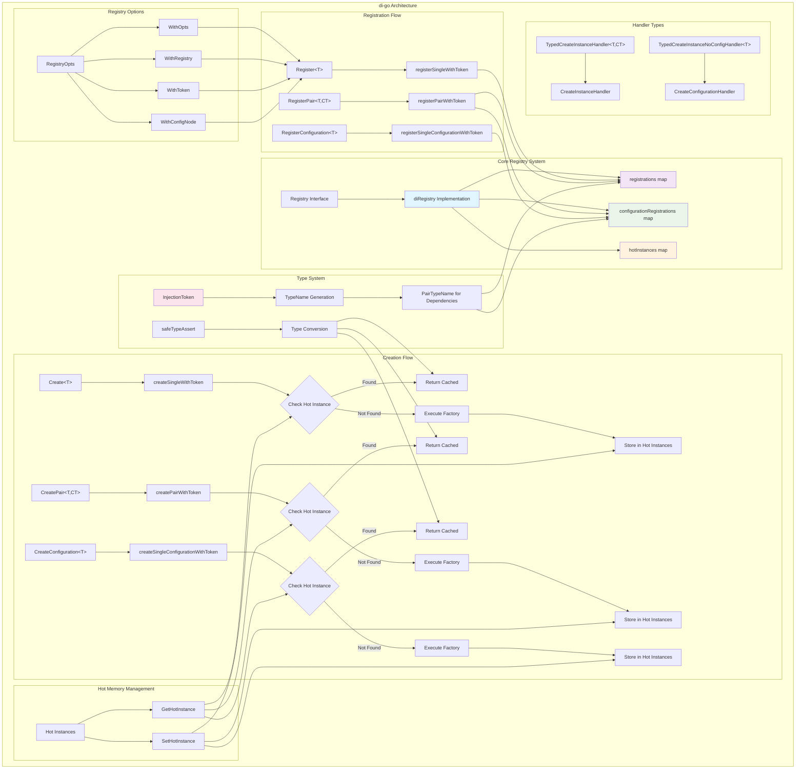

# di-go

Dependency injection for Go, built on generics. You register a factory per type, ask for the type, and di-go builds the graph. There is no reflection magic to debug and no code generation: a dependency is a function you can read.

[](https://pkg.go.dev/github.com/pixie-sh/di-go)
[](LICENSE)

Made by [Pixie](https://pixie.sh). Project page: <https://pixie-sh.github.io/di-go/>

## Features

- **Type-safe:** `Create[*UserService](ctx)` returns a `*UserService`, checked by the compiler.
- **Factory style:** every dependency is created by a plain function that asks for what it needs.
- **Configuration injection:** a service can be registered together with its configuration type, and di-go finds the right node of your config for it.
- **Tokens:** register the same type more than once (primary and replica database, two caches) and pick one by name.
- **Config references:** `${di.path.to.node}` in JSON reuses another node, so shared settings are written once.
- **Singletons:** an instance is created on first use and reused afterwards.
- **Isolated registries:** build a separate registry for tests instead of touching the global one.

## Install

```sh
go get github.com/pixie-sh/di-go
```

## Quick start

```go
package main

import (
	"fmt"

	di "github.com/pixie-sh/di-go"
)

type Database struct{ DSN string }
type UserRepository struct{ DB *Database }
type UserService struct{ Repo *UserRepository }

func main() {
	_ = di.Register[*Database](func(di.Context, *di.RegistryOpts) (*Database, error) {
		return &Database{DSN: "postgres://localhost/app"}, nil
	})

	_ = di.Register[*UserRepository](func(ctx di.Context, _ *di.RegistryOpts) (*UserRepository, error) {
		db, err := di.Create[*Database](ctx)
		if err != nil {
			return nil, err
		}
		return &UserRepository{DB: db}, nil
	})

	_ = di.Register[*UserService](func(ctx di.Context, _ *di.RegistryOpts) (*UserService, error) {
		repo, err := di.Create[*UserRepository](ctx)
		if err != nil {
			return nil, err
		}
		return &UserService{Repo: repo}, nil
	})

	svc, err := di.Create[*UserService](di.NewContext())
	if err != nil {
		panic(err)
	}
	fmt.Println(svc.Repo.DB.DSN) // postgres://localhost/app
}
```

Registration order does not matter. Nothing is built until `Create` is called, and then only what the requested type needs.

## Usage

### Configuration injection

A service usually needs settings. `RegisterPair` registers a type together with its configuration type, and the factory receives the configuration as a typed argument.

```go
type DatabaseConfig struct {
	Host string `json:"host"`
	Port int    `json:"port"`
}

// A configuration type says how to find a child node by path.
func (c DatabaseConfig) LookupNode(path string) (any, error) {
	return di.ConfigurationNodeLookup(c, path)
}

func newDatabase(_ di.Context, _ *di.RegistryOpts, cfg DatabaseConfig) (*Database, error) {
	return &Database{DSN: fmt.Sprintf("%s:%d", cfg.Host, cfg.Port)}, nil
}
```

`ConfigurationNodeLookup` walks a struct by its `json` tags, so most configuration types implement `LookupNode` in one line. `ConfigurationLookup[T]` is the ready-made resolver that reads the node from the context's configuration.

### Tokens: more than one instance of a type

An injection token names a registration. It is also the path of the configuration node, so the token `primary` reads the `primary` node of your config.

```go
type AppConfig struct {
	Primary DatabaseConfig `json:"primary"`
	Replica DatabaseConfig `json:"replica"`
}

func (c *AppConfig) LookupNode(path string) (any, error) {
	return di.ConfigurationNodeLookup(c, path)
}

var (
	PrimaryDB = di.RegisterInjectionToken("primary")
	ReplicaDB = di.RegisterInjectionToken("replica")
)

func main() {
	_ = di.RegisterPair[*Database, DatabaseConfig](newDatabase, di.ConfigurationLookup[DatabaseConfig], di.WithToken(PrimaryDB))
	_ = di.RegisterPair[*Database, DatabaseConfig](newDatabase, di.ConfigurationLookup[DatabaseConfig], di.WithToken(ReplicaDB))

	cfg := &AppConfig{
		Primary: DatabaseConfig{Host: "db.internal", Port: 5432},
		Replica: DatabaseConfig{Host: "replica.internal", Port: 5433},
	}
	ctx := di.NewContext(cfg)

	primary, _ := di.CreatePair[*Database, DatabaseConfig](ctx, di.WithToken(PrimaryDB))
	replica, _ := di.CreatePair[*Database, DatabaseConfig](ctx, di.WithToken(ReplicaDB))

	fmt.Println(primary.DSN) // db.internal:5432
	fmt.Println(replica.DSN) // replica.internal:5433
}
```

Other factories ask for a specific one the same way:

```go
_ = di.Register[*UserRepository](func(ctx di.Context, _ *di.RegistryOpts) (*UserRepository, error) {
	db, err := di.CreatePair[*Database, DatabaseConfig](ctx, di.WithToken(PrimaryDB))
	if err != nil {
		return nil, err
	}
	return &UserRepository{DB: db}, nil
})
```

Use `WithConfigNodePath("some.other.path")` when the configuration node is not named after the token.

### References inside the configuration

`${di.path.to.node}` in a JSON config is replaced by the node it points to. Shared settings are written once and reused.

```json
{
  "defaults": { "host": "db.internal", "port": 5432 },
  "primary": "${di.defaults}",
  "replica": { "host": "replica.internal", "port": 5433 }
}
```

Resolve the references while unmarshalling:

```go
func (c *AppConfig) UnmarshalJSON(b []byte) error {
	type plain AppConfig
	return di.UnmarshalJSONWithDIResolution(b, (*plain)(c))
}

var cfg AppConfig
err := json.Unmarshal(raw, &cfg) // cfg.Primary is now {db.internal 5432}
```

`ResolveDIReferences`, `FindDIReferences` and `ValidateDIReferences` are available when you want to resolve or check a document yourself.

### Singletons

An instance is created the first time it is requested and reused afterwards.

```go
a, _ := di.Create[*UserService](ctx)
b, _ := di.Create[*UserService](ctx)
fmt.Println(a == b) // true
```

### Isolated registries

`Register` and `Create` use the global `di.Instance` by default. Pass your own registry to keep tests independent.

```go
reg := di.NewRegistry()

_ = di.Register[*Database](func(di.Context, *di.RegistryOpts) (*Database, error) {
	return &Database{DSN: "memory"}, nil
}, di.WithRegistry(reg))

db, err := di.Create[*Database](di.NewContext(), di.WithRegistry(reg))
```

You can also implement the `Registry` interface yourself, for example to count or intercept creations.

### Errors

Failures are [errors-go](https://github.com/pixie-sh/errors-go) errors with a code, and they say which dependency was missing and where in the graph.

```go
_, err := di.Create[*Mailer](ctx)
// ErrorCreatingDependencyErrorCode-75503 failed to create dependency 'main.Mailer' without token with breadcrumbs '[]';
// DependencyMissingErrorCode-75503 dependency not registered: main.Mailer

if e, failed := errors.Has(err, di.ErrorCreatingDependencyErrorCode); failed {
	// e.NestedError holds the cause, here a DependencyMissingErrorCode error
}
```

### The context

`di.Context` is a `context.Context` that also carries the configuration. `NewContext` accepts any mix of a `context.Context`, another `di.Context`, a `Configuration` or raw config data (`map[string]any`).

```go
ctx := di.NewContext(parentCtx, cfg)
```

## API reference

### Registration

| Function | Registers |
| --- | --- |
| `Register[T](factory, opts...)` | a type that needs no configuration |
| `RegisterPair[T, CT](factory, configFactory, opts...)` | a type `T` created from its configuration `CT` |
| `RegisterConfiguration[CT](configFactory, opts...)` | a configuration type on its own |
| `RegisterInjectionToken(name)` | a token; the name must not be empty, start or end with a dot, or contain consecutive dots |

### Creation

| Function | Returns |
| --- | --- |
| `Create[T](ctx, opts...)` | an instance registered with `Register` |
| `CreatePair[T, CT](ctx, opts...)` | an instance registered with `RegisterPair` |
| `CreateConfiguration[CT](ctx, opts...)` | a configuration |

### Options

| Option | Effect |
| --- | --- |
| `WithToken(token)` | pick a named registration |
| `WithRegistry(registry)` | use a registry other than the global one |
| `WithConfigNodePath(path)` | read the configuration from this path |
| `WithConfigNode(node)` | use this configuration value directly |
| `WithOpts(opts)` | replace all options at once |

### Configuration

```go
type Configuration interface {
	LookupNode(lookupPath string) (any, error)
}
```

| Function | Purpose |
| --- | --- |
| `ConfigurationLookup[T](ctx, opts)` | ready-made resolver for `RegisterPair` and `RegisterConfiguration` |
| `ConfigurationNodeLookup(c, path)` | find a child of a struct by dot-separated `json` names |
| `UnmarshalJSONWithDIResolution(data, dest)` | unmarshal JSON after resolving `${di...}` references |

## Architecture



## More examples

The test files cover larger cases: complex service hierarchies, configuration sharing, custom registries and multi-level injection.

## License

[MIT](LICENSE)
